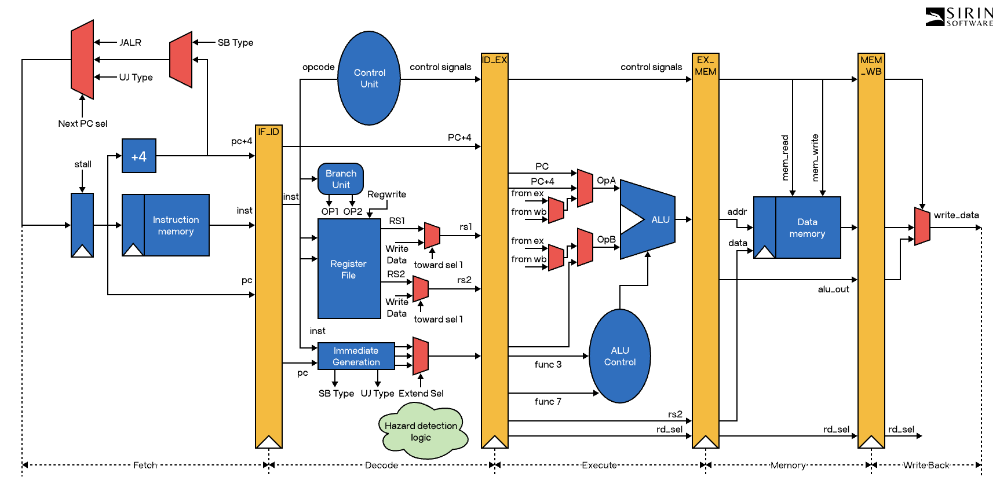
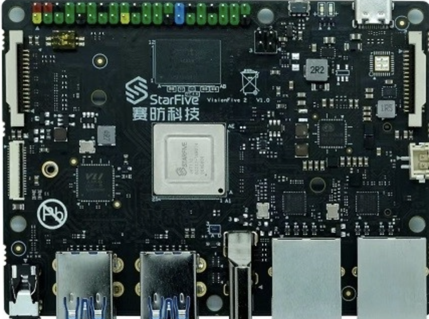

<h1 style="text-align: center;">TOY MACHINE</h1>

This is a simple design of a cpu simulation emulating RISC-V like characteristics. RISC-V pipeline architecture trys to improve processing efficiency by breaking down instruction execution into five stages. This hopes to enable the simultaneous processing of multiple instructions. The five stages involve retrieving the instruction from memory, decoding the instruction, performing the specified operation, accessing memory for data transfer, and writing the results back to the register file. 

The pipeline structure permits the processor to handle varius instructions simultaneously, enhancing performance. This also presents challenges, such as pipeline hazards which need to be addressed using methods like forwarding, stalling, and branch prediction to maintain efficiency and precision in execution.

Every stage of the pipeline is always occupied by an instruction after the first 4 clock cycles.

<h3>REGISTER FILE</h3>

Register file consists of a set of registers used for holding data during instruction execution. In this simple implementation, the number of registers is 8: R[0], R[1], R[2], R[3], R[4], R[5], R[6], R[7]. Each register is of type 32-bit integer (int32_t).

PC, stores the address of the next instruction to be fetched from memory. During instruction execution, the PC is incremented to point to the next instruction in memory. When a branch or jump instruction is executed, the PC is updated to point to the new target address. 

IR, stores the current instruction fetched from memory using the address specified by the PC. The IR is an abbreviation for instruction register. The IR temporarily stores the instruction currently being decoded or executed.

The program also contains 4 pipeline registers for storing information traveling along through the pipeline: IF/ID, ID/EX, EX/MEM, MEM/WB. These pipeline registers prevent data overwrite as multiple instructions pass through the pipeline concurrently. 

<h3>ISA</h3>

The instruction set serves as the foundation of the RISC-V architecture. It defines a set of basic instructions for integer operations, control flow, and memory access. For this simple implementation 12 instructions have been defined.

<h5>Arithmetic and Logical Operations</h5>
These instructions perform basic calculations on data in registers.

- ADD: adds the contents of two registers and stores the result in a destination register.
- SUB: subtracts the contents of one register from another and stores the result in a destination register.

<h5>Memory Access</h5>
These instructions are responsible for transferring data between the processor's registers and memory.

- LOAD, LOAD_B: these instructions read data from memory and store it in a register.
- STORE, STORE_B: these instructions write data from a register to memory.

<h5>Control Flow</h5>
These instructions alter the flow of program executions by changing the program counter (PC).

- BEQ, BLT, BNE, BGE: these instructions allow for conditional branching based on register values. 
- JUMP: this instruction jumps to a specified address unconditionally.

<h5>Data Movement</h5>

- LOAD_I: this instruction places an immediate value integer into a destination register.
- MOVE: this instruction takes a value from a source register and places that value into a destination register, not changing the source register.

<h5>Termination</h5>

- HALT: this instruction is your exit specifier, when read the program terminates

<h3>HAZARDS</h3>

For data hazards; the current IF/ID pipeline register's source register values are compared to the current ID/EX and EX/MEM pipeline register's destination register value. If the any of the register number values happen to be equal IF/ID is stalled in the next clock cycle.

For control hazards; if a branch is taken, the program counter is changed from the next sequential address in line to the target address specified by the label in the branch instruction. This is done in the execute stage. Upon a branch being taken, the pipeline registers currently scheduled to be next up in IF/ID and ID/EX are flushed.

For control hazard; if an unconditional JUMP branch is taken, the program counter is updated to the target address. This is done in the decode stage. Upon a branch being taken, the pipeline register currently scheduled to be next up in the IF/ID is flushed. 

<h3>TO COMPILE</h3>
make clean

make 

<h3>TO RUN</h3>
./main input.asm

