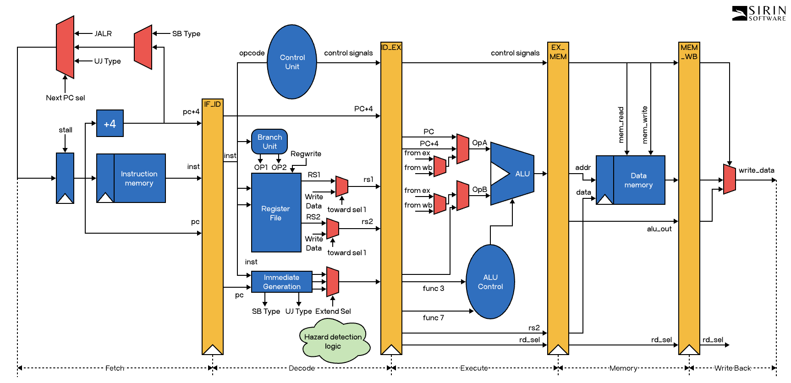

# Toy Machine

This is a simple design of a cpu simulation emulating RISC-V like characteristics. RISC-V pipeline architecture trys to improve processing efficiency by breaking down instruction execution into five stages. This hopes to enable the simultaneous processing of multiple instructions. The five stages involve retrieving the instruction from memory, decoding the instruction, performing the specified operation, accessing memory for data transfer, and writing the results back to the register file. 

The pipeline structure permits the processor to handle varius instructions simultaneously, enhancing performance. This also presents challenges, such as pipeline hazards which need to be addressed using methods like forwarding, stalling, and branch prediction to maintain efficiency and precision in execution.

## Project layout

```text
toy_machine/
├── architectureLayer/
    └── branch_predictor/
        └── branch_predictors.c
        └── branch_predictors.h
    └── labels/
        └── label.c
        └── label.h
    └── initial_state.h
    └── machine_state.h
├── docker/
    └── Dockerfile
    └── hw_check.sh
├── obj/
    └── branch_predictors.o
    └── decode.o
    └── execute.o
    └── fetch.o
    └── instruction_parser.o
    └── label.o
    └── main.o
    └── mem.o
    └── program_loader.o
    └── utils.o
    └── writeback.o
├── pipeline/
    └── stages/
        └── decode.c
        └── execute.c
        └── fetch.c
        └── mem.c
        └── utils.c
        └── wb.c
    └── pipeline.h
    └── utils.h
├── program/
    └── get_program/
        └── instruction_parser.c
        └── program_loader.c
    └── program.h
├── main
├── main.c
├── Makefile
├── README.md
├── test.asm
```

## ├── architectureLayer/
└── branch_predictor/  
branch_predictors.c:  
&nbsp;&nbsp;&nbsp;&nbsp;Directory consists of all branch predictor logic. Four branch predictors are used: NT, BTFN, 1BIT, and 2BIT.  
&nbsp;&nbsp;&nbsp;&nbsp;NT - predict not-taken, always predicts a branch condition will not be taken, npc = pc + 1  
&nbsp;&nbsp;&nbsp;&nbsp;BTFN - predicts taken if the branch target pc is at or before the branch pc, otherwise predicts not-taken  
&nbsp;&nbsp;&nbsp;&nbsp;1BIT - A branch history table of 16 entries, each holding a single bit (the last outcome seen). The branch at pc p uses entry p mod 16. 1BIT predicts whatever that entry holds, and after the branch executes the entry is set to the actual outcome. All entries start at not-taken.  
&nbsp;&nbsp;&nbsp;&nbsp;2BIT - Separate 16-entry branch history table indexed the same way, where each entry is a counter from 0 to 3. Predicts taken if the counter is >= 2 and not taken otherwise. After branch executes, counter goes up by 1 if the branch was taken and down by 1 if it was not, staying between 0 and 3. All entries start at 1.  

└── labels/  
label.c, labels.h:  
&nbsp;&nbsp;&nbsp;&nbsp;Directory is responsible for handling labels in relationship to branch instructions.  
&nbsp;&nbsp;&nbsp;&nbsp;LabelEntry - This is a struct with two members; position and resolved. Position is an integer, where the label is located. Resolved is an integer indicating if the label has been resolved or not.  
&nbsp;&nbsp;&nbsp;&nbsp;NamedLabel - This is a struct with two members; name and id. Name is the string literal of the label. Id is an integer showing identification corresponding to name.  
&nbsp;&nbsp;&nbsp;&nbsp;LocalLabelTable - This is a struct with two members; a LabelEntry and a NamedLabel. LocalLabelTable is the relationship between the label identifier and the id's final location.  
&nbsp;&nbsp;&nbsp;&nbsp;In label.c, functions find_or_create_label, bind_label, and resolve_label help utilize variables defined in labels.h. They pair branch instructions with their correct labels and the locations to branch to upon a branch condition resulting in taken.  

└── machine_state.h  
&nbsp;&nbsp;&nbsp;&nbsp;Header file defining the architectural state. Main items to be used throughout implementation.  
&nbsp;&nbsp;&nbsp;&nbsp;Opcode - define the available instructions to use: LOAD_I, ADD, SUB, MOVE, LOAD, STORE, LOAD_B, STORE_B, BEQ, BNE, BLT, BGE, JUMP, HALT.  
&nbsp;&nbsp;&nbsp;&nbsp;Instructions - define the information needed to perform operations on operands properly (Instrn).  
&nbsp;&nbsp;&nbsp;&nbsp;Pipeline Registers - registers located in-between pipeline stages to store information and prevent data overwrite (IF/ID, ID/EX, EX/MEM, MEM/WB).  
&nbsp;&nbsp;&nbsp;&nbsp;CPU - the instruction register, program counter, and 8 general purpose registers.  
&nbsp;&nbsp;&nbsp;&nbsp;MEM - memory, 1024 unsigned char locations.  

## ├── pipeline/
└── stages/  
&nbsp;&nbsp;&nbsp;&nbsp;fetch.c:  
&nbsp;&nbsp;&nbsp;&nbsp;&nbsp;&nbsp;&nbsp;&nbsp;This is stage one in the 5-stage standard pipeline. IF is responsible for grabbing the instruction in the instruction register and moving it into the IF/ID pipeline register. Fetch increments the program counter. If the instruction in the instruction register is of type branch, then fetch initializes the branch predictors.  
&nbsp;&nbsp;&nbsp;&nbsp;decode.c:  
&nbsp;&nbsp;&nbsp;&nbsp;&nbsp;&nbsp;&nbsp;&nbsp;This is stage two in the 5-stage standard pipeline. ID is responsible for grabbing the instruction in the IF/ID pipeline register, decoding information, and moving it along properly to the ID/EX pipeline register. In this implementation, decode is responsible for alot. ID recieves forwarding from older instructions in the pipeline if valid, checks branching conditions, performs the correct location as to where to branch, and updates the 1BIT and 2BIT branch tables.  
&nbsp;&nbsp;&nbsp;&nbsp;execute.c  
&nbsp;&nbsp;&nbsp;&nbsp;&nbsp;&nbsp;&nbsp;&nbsp;This is stage three in the 5-stage standard pipeline. EX grabs the information in the ID/EX pipeline register, performs calculations required of instruction semantics, and moves the information along to the EX/MEM pipeline register.  
&nbsp;&nbsp;&nbsp;&nbsp;mem.c  
&nbsp;&nbsp;&nbsp;&nbsp;&nbsp;&nbsp;&nbsp;&nbsp;This is stage four in the 5-stage standard pipeline. It uses the information in the EX/MEM pipeline register to perform necessary manipulations with memory (LOADS, STORES). If an instruction is not required memory, then MEM places the items in the EX/MEM pipeline register into the MEM/WB pipeline register to prepare for writeback.  
 &nbsp;&nbsp;&nbsp;&nbsp;wb.c  
 &nbsp;&nbsp;&nbsp;&nbsp;&nbsp;&nbsp;&nbsp;&nbsp;This is stage five in the 5-stage standard pipeline. It takes the information in the MEM/WB pipeline register and writes the reg_write variable into the register file corresponding to the register number dest.  
 &nbsp;&nbsp;&nbsp;&nbsp;utils.c  
 &nbsp;&nbsp;&nbsp;&nbsp;&nbsp;&nbsp;&nbsp;&nbsp;This file contains utility functions: wrapAddress, writes_register, uses_register, data_hazard, read_operands, forward_values, and forward_operands.  

 ## ├── program/
 └── get_program/  
 &nbsp;&nbsp;&nbsp;&nbsp;get_program is a directory consisting of instruction_parser.c and program_loader.c. The directory is responsible for reading the input .asm file, grabbing the instructions inside the .asm file, parsing the instructions, and placing the instruction in file order into a program array to be read by main and performed on by the 5-stages in the pipeline.  

 ## ├── main.c
 &nbsp;&nbsp;&nbsp;&nbsp;The driver, entry point where all items work together to complete operations on operands successfully until the end of the program array is reached, HALT.  

 ## Forwarding, stalling, and other information
 - To allow instructions being fetched to use newly written register files, writeback happens in first half of clock cycle and fetch happens in second half of clock cycle.  
 - Data hazards check if the current instruction in the ID stage needs a register value that an earlier instruction in the pipeline hasn't finished producing yet. It checks for destinations in EX and MEM with sources in ID. Results in a data_stall. It primarily checks for two types of RAW hazards:  
 &nbsp;&nbsp;&nbsp;&nbsp;1. Load-use hazards - an instruction needs a register value that a preceding LOAD or LOAB_B hasn't retrieved from memory yet.  
 &nbsp;&nbsp;&nbsp;&nbsp;2. Branch hazards: A branch instruction needs a register value that a preceding instruction hasn't produced yet.  
 - Forwarding is received in decode between instructions in EX or MEM. If a source is dependent upon a destination before the destination value has been written to the register file, newly computed values in EX or MEM can be forwarded to the ID/EX pipeline register before reaching writeback to confirm proper values entering execute.  
 - In decode, for branch instructions, the next instruction fetched from memory is always the 2BIT prediction value. The prediction is checked against the condition in the decode as well. If the prediction is correct proceed with no further edit, if the prediction is incorrect edit the pc to the correct location.  

 ## Set-up
 ```text
 to compile:
    make clean
    make

to run:
    ./main <input.asm>
 ```
